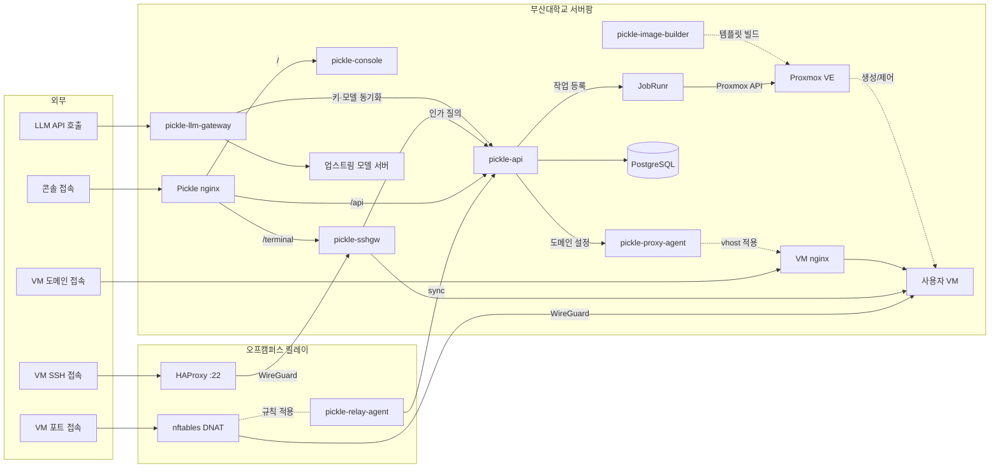

# pickle-relay-agent

부산대학교 클라우드 플랫폼(Pickle)의 오프캠퍼스 릴레이에서 nftables DNAT을 제어하는
에이전트예요.

캠퍼스 방화벽이 인바운드를 막기 때문에, 사용자 포트는 오프캠퍼스 릴레이 호스트가 대신
받아 캠퍼스가 아웃바운드로 개통한 WireGuard 터널로 VM까지 넘겨요. 이 에이전트는 그
릴레이 호스트에서 돌아가요.

```
인터넷 ──공인 포트──▶ 릴레이 호스트 nftables DNAT ──WireGuard──▶ 캠퍼스 ──▶ 사용자 VM
                            ▲ netlink
                       relay-agent ── 매핑 스냅샷(JSON, generation) 조회 ──▶ 플랫폼 API
```

플랫폼이 정한 매핑 스냅샷을 주기적으로 가져와 반영하고, 적용 상태와 사용량을 보고해요.
로컬 파일을 소스로 사용하는 모드는 부트스트랩과 테스트용이에요.

## 주요 기능

플랫폼은 VM 신청·승인·생성, SSH와 웹 터미널 접속, 도메인 공개, 만료와
삭제까지를 다뤄요. 이 레포지토리가 맡는 부분은 아래와 같아요.

- **매핑 수렴**: 플랫폼이 정한 공인 포트에서 VM 포트로 가는 매핑을 릴레이 호스트의
  방화벽에 반영해요.
- **남용 가드**: 매핑마다 동시 연결 수와 신규 연결 속도에 상한을 두어, 한 매핑에 몰린
  트래픽이 다른 접속 경로를 밀어내지 못하게 해요.
- **오래된 상태 폐기**: 보존한 스냅샷이 허용 창을 넘기면 버리고 빈 집합으로 수렴해요.
- **사용량 보고** — 매핑별 연결 수와 트래픽, 가드가 막은 횟수를 집계해 플랫폼에 보고해요.
- **부팅 복구**: 릴레이가 재시작해도 마지막 상태를 다시 적용해 매핑이 살아나요.

## 동작 방식

- **소유 범위**: `ip pickle_relay_dnat`만 만들고 교체해요. 다른 테이블은 지우지 않아요.
  정적 배관 테이블은 호스트 부팅 설정이 관리해요.
- **적용은 원자적이에요.** 테이블 삭제, 재생성, 전체 규칙을 단일 netlink 배치로
  커밋해요. 이전 규칙 전체이거나 새 규칙 전체이거나 둘 중 하나예요.
- **실패하면 세대를 올리지 않아요.** 보고 세대를 그대로 두고 다음 주기에 재시도해요.
- **입력을 매번 검증해요.** 모든 값을 타입 파싱(`netip.Addr`, 포트 정수)하고 대상
  CIDR 화이트리스트, 공인 포트 대역, 중복 여부를 매 로드마다 다시 확인해요.
- **fail-open에 경계가 있어요.** 마지막 적용 스냅샷을 보존해 두고 부팅 때
  재적용해요. 허용 창을 넘겼으면 폐기하고 빈 집합으로 수렴해요. 허용 창은 플랫폼의 IP 격리
  창과 같은 값으로 둬요. 부팅 재적용이 실패하면 종료하지 않고 폴링 루프로 들어가요.
  세대는 0으로 보고하고, 주기마다 빈 집합 수렴을 다시 시도해요.
- **netlink 직접 호출** — `nft(8)`를 실행하지 않아 자식 프로세스가 없고, systemd
  유닛이 `SystemCallFilter=@system-service`와 `MemoryDenyWriteExecute=yes`를 켠 채
  돌아가요. exec 헬퍼를 추가한다면 이 하드닝 블록부터 다시 봐야 해요.
- **방화벽을 결정하는 값에는 기본값이 없어요.** 대상 CIDR, 공인 대역, 인터페이스,
  스냅샷 허용 창은 없으면 기동을 거부해요.

## 스냅샷 형식

sync 응답 본문, `apply` 입력 파일, 보존 파일이 모두 같은 형태예요. 예시는 문서화
대역(RFC 5737) 주소를 사용해요.

```json
{ "generation": 42,
  "mappings": [
    { "id": 101, "proto": "tcp", "publicPort": 12345,
      "targetAddr": "192.0.2.23", "targetPort": 8080 } ] }
```

`proto`는 `tcp` 또는 `udp`예요. `publicPort`는 릴레이 예약 대역 안이어야 하고 대역
하한은 1024예요. `targetAddr`는 화이트리스트 CIDR 안의 IPv4이며, 같은
(proto, publicPort) 중복은 허용하지 않아요. 정지된 매핑은 스냅샷에서 빠진 채로
내려와요.

매핑에는 가드 상한 필드 `ctMax`, `newConnRate`, `newConnBurst`, `perSourceRate`,
`perSourceBurst`를 선택적으로 담을 수 있어요. 필드를 생략하면 릴레이의 환경 변수
기본값을 사용하고, `0`이면 그 매핑에서 해당 가드를 끄며, 그 외 값이면 기본값을
대체해요. 버스트 필드는 짝이 되는 rate 필드가 0이 아닌 값으로 함께 와야 하고, 다섯
필드 모두 1,000,000 이하여야 해요. 상한을 넘는 값은 매핑 id가 붙은 검증 오류로
되돌려 보내요.

매핑별 출발지 정책은 선택 필드 `sourcePolicy`로 전달해요.

```json
{ "sourcePolicy": { "allowedCidrs": ["198.51.100.0/24"] } }
```

필드를 생략하면 기존 접근 동작을 유지해요. `{"allowedCidrs":[]}`는 신규 연결을 모두
거부하고, 전체 공개는 `0.0.0.0/0`으로 명시해요. canonical IPv4 네트워크 CIDR을 최대
128개 받으며 `null`, 목록 누락, 중복·호스트 비트·IPv6·DNS 이름은 거부해요. 교내
프리셋은 플랫폼이 CIDR로 확장해요. 잘못된 정책은 스냅샷 전체를 거부하므로 이전 규칙과
적용 세대를 유지해요. 보존·부팅 재적용에서도 정책의 생략과 빈 목록을 구분해요.

출발지 검사는 공인 ingress의 주소 변환과 남용 가드보다 먼저 실행해요. NAT 흐름의 첫
패킷에만 적용하므로 정책 변경으로 기존 conntrack을 비우거나 진행 중인 세션을 종료하지
않아요. IPv6 매핑을 생성하거나 IPv6 정책을 IPv4로 바꾸어 적용하지 않아요.

## 동기화

동기화는 단일 엔드포인트에 대한 HTTP 폴링이에요. 요청 하나가 보고와 조회를 겸해요.

```
POST {PICKLE_RELAY_SYNC_URL}
Authorization: Bearer {PICKLE_RELAY_SYNC_TOKEN}

{ "appliedGeneration": 41, "agentVersion": "v1.2.0",
  "capabilities": ["source-acl-v1", "mapping-retirement-v1"],
  "retirementLedgerId": "11111111-2222-4333-8444-555555555555",
  "mappingIdHighWater": 101, "flowMarkHighWater": 42, "retirementHighWater": 41,
  "managedGenerationHighWater": 41,
  "retirementReceipts": [],
  "lastError":  [ { "mappingId": 101, "message": "..." } ],
  "counters":   [ { "mappingId": 101, "newConns": 12, "inPackets": 340, "inBytes": 51200,
                    "outPackets": 300, "outBytes": 48000,
                    "rateDropped": 0, "connDropped": 0, "perSourceDropped": 7 } ] }
```

응답은 두 형태예요. 변경이 없으면 `{ "generation": 41 }`만 내려오고, 바뀌었으면
`{ "generation": 42, "mappings": [...] }` 전체 스냅샷이 내려와요. Managed 응답은
`retirements`와 `acknowledgedRetirementHighWater`도 명시해요. 매핑이 없는
응답의 generation이 보고한 적용 세대와 다르면 프로토콜 위반으로 보고 아무것도
적용하지 않아요.

`capabilities`는 이 에이전트가 지원하는 정책 형식이에요. 플랫폼은 `source-acl-v1`을
보고한 에이전트에만 `sourcePolicy`를 보내야 해요. capability 광고는 실제 외부 접속
검증이나 특정 정책의 적용 완료를 뜻하지 않아요. 정책 변경에는 기존 세대 증가와
`appliedGeneration` 확인 절차를 사용해요.

릴레이 쪽에는 출발지 정책을 따로 켜는 환경 변수가 없어요. 이 바이너리를 배포하면 매
동기화 요청이 capability를 보고해요. 플랫폼 producer는 저장된 과거 값이 아니라 현재
heartbeat에서 그 값을 확인한 뒤 활성화해요. 기존 공인 interface, target CIDR과 sync
자격증명이 준비 조건이며, capability 확인 뒤에도 외부 source의 허용·거부를 따로 검증해요.

`mapping-retirement-v1`은 새 managed mapping의 기존 conntrack 흐름을 안전하게 퇴역시키는
형식이에요. 각 매핑은 재사용하지 않는 32-bit `flowMark`를 가지며, 첫 패킷을 DNAT하기 전에
conntrack mark로 저장해요. 매핑을 정지하거나 삭제한 스냅샷은 `retirements`에 UUID,
mapping id, generation, 기존 proto/public port/target, mark와 tuple hash를 함께 보내요.
에이전트는 DNAT를 제거하는 같은 원자적 table 교체에서 기존 흐름의 양방향을 mark와 원래
tuple로 찾아 DROP fence를 설치해요. 실제 규칙 readback 뒤 native ctnetlink로 mark, protocol,
원래 public port와 변환된 target tuple이 모두 일치하는 conntrack만 삭제하고, 재조회 결과가
0일 때만 `CLEARED` receipt를 보고해요. 일반 출발지 정책이나 가드 수정은 이 삭제 경로를
호출하지 않으며 기존 흐름과 mark를 유지해요. 구현은
[`github.com/ti-mo/conntrack` v0.6.0](https://pkg.go.dev/github.com/ti-mo/conntrack@v0.6.0)의
exact-mark `DumpFilter`, full-flow `Delete` API를 사용해요.
규칙 readback은 `github.com/google/nftables`의 공식 commit `f9b52ed2ba65`을 고정해요.
최신 stable v0.3.0은 현재 Linux kernel이 1 byte로 반환하는 conntrack direction을 4 byte로
decode해 readback이 실패하며, 이 commit은 marshal/decode를 모두 1 byte로 바로잡아요.

ledger UUID, mapping epoch/mark/retirement high-water, 현재 active identity와 아직 ACK되지 않은
퇴역 tuple은 StateDirectory의 별도 원장에 원자적으로 저장해요. API DB가 이전 시점으로
복원되어도 high-water 이하의 예전 id나 mark를 다시 활성화하지 않아요. API가 연속
`acknowledgedRetirementHighWater`를 응답하고 fence 제거 직전 zero 재확인까지 성공한 tuple만
원장과 kernel에서 정리해요. 원장 교체·누락, high-water 역행, tuple 충돌, 동시에 대기 중인
retirement 4,096개 초과는 fail-closed로 처리해요. 한 번 managed identity가 arm된 릴레이는 이
capability가 없는 바이너리로 되돌릴 수 없어요.

`retirement-ledger.json`이 손상되었거나 managed snapshot/kernel marker가 남은 채 ledger만
사라지면 에이전트는 owned table의 DNAT를 비우고 기존 DNAT conntrack 전달을 양방향 차단한
채 오류를 유지해요. 기존 ledger identity를 복원해 재시작하기 전에는 정상 동기화로
돌아가지 않아요. ledger, snapshot, kernel marker가 모두 사라진 상태는 진짜 최초 기동과
로컬에서 구분할 수 없어요. 이때 armed API는 새 ledger identity를 자동 수락하지 않아야
하며, 운영자가 cached DNAT를 별도로 fence·검사한 뒤에만 명시적으로 재등록할 수 있어요.

격리된 Linux network namespace acceptance는 실제 UDP DNAT 흐름 세 개를 만들어 exact
retirement만 삭제하고 다른 mark와 다른 target의 conntrack ID가 유지되는지 확인해요.
같은 client 5-tuple을 새 epoch/mark로 재개한 패킷 전달과, source ACL 변경 뒤 기존 UDP
흐름은 유지하면서 새 source port만 차단되는 것도 검증해요. 이 검사는 실제 외부 IP,
TCP 세션, 운영 relay, RTO를 증명하지 않으며 운영 활성화 전 별도 검증이 필요해요.

- **응답 파싱은 엄격해요.** 모르는 필드가 있으면 스냅샷 전체를 거부해요. 그래서
  응답에 필드를 추가하기 전에 에이전트를 먼저 업그레이드하는 것이 명세 규칙이에요.
- **counters는 기동 이후 누적값이에요.** 에이전트가 재시작하면 0부터 다시 시작하므로,
  서버는 값이 줄어든 것을 재시작으로 처리해요.
- **counters는 보고 한 건당 최대 2000행**이에요. 매핑이 더 많으면 이전 보고에 이어서
  순환해 보내요. 건너뛴 회차의 증가분도 누적값에 포함돼요. 요청 본문 상한은 1 MiB예요.
- **lastError는 최대 8건**, 메시지는 제어 문자를 제거하고 1024바이트로 잘라 보내요.
- 요청 타임아웃은 4초로, 최소 폴링 주기(5초)보다 짧게 두어 주기가 겹치지 않아요.

다운그레이드 주의: 가드 상한 필드가 담긴 보존 스냅샷은 이 필드를 모르는 구버전
바이너리의 부팅 재적용에서 거부되어 빈 상태로 수렴해요(fail-closed). 동기화 응답에도
같은 필드가 들어 있는 동안은 그 역시 거부되므로, 상한 필드를 사용하는 릴레이의
포워딩은 구버전으로 되돌리는 순간 끊겨요.

## 남용 가드

매핑마다 세 겹의 상한이 붙어요. 출발지 IP당 신규 연결 rate limit, 매핑 전체의 신규
연결 rate limit, 그리고 `ct count`(동시 연결 상한)이에요. 기본값은 모두 조이는
방향(drop 상한)만 있어 방화벽을 넓히지 않아요. 스냅샷의 매핑별 상한 필드는
기본값을 넓히는 쪽으로도 대체할 수 있어요. 이 값은 인증된 플랫폼에서 내려줘요.

출발지별 가드는 매핑마다 동적 셋(원소 60초 만료, 최대 4096 출발지)에 IP별 토큰
버킷을 얹은 것으로, 한 출발지의 폭주가 매핑 전체의 버킷을 비워 다른 사용자까지
막는 일을 줄여요. 셋이 가득 차면 새 출발지는 매핑 전체 가드로 넘어가요. 규칙
순서는 출발지 정책 → 출발지별 rate → 전체 rate → `ct count` → DNAT이에요.

매핑마다 이름 있는 counter 여섯 개(신규 연결, 방향별 트래픽 두 개, 가드별 드롭 세
개)를 만들어 동기화 보고에 사용해요. 트래픽은 별도 forward 체인에서 집계하며,
이 체인은 패킷을 막지 않아요. 규칙 교체 때
counter가 0으로 돌아가는 것은 에이전트가 누적으로 보정해 보고해요.

`ct count`가 세는 것은 살아 있는 연결이 아니라 conntrack 엔트리 수이고 TIME_WAIT도
포함해요. 그래서 매핑당 정상 지속 한도는 대략 `상한 ÷ TIME_WAIT 수명`이에요. 릴레이는
순수 NAT 포워더라 TIME_WAIT를 30초로 두고 있어, 기본 상한 512에서 매핑당 초당 17연결
정도를 견뎌요. 짧은 연결이 잦은 서비스를 얹는다면 이 값을 기준으로 상한을 올려야 해요.

`NEW_CONN_BURST=0`은 "버스트 없음"이 아니라 커널이 5패킷 허용치로 보정하는 값이에요.
대역에 릴레이 자체 서비스 포트가 들어 있으면 기동을 거부해요. 가드 규칙에는 counter를
붙여 드롭이 관측되므로, 정상 트래픽 오탐과 실제 차단을 구분할 수 있어요.

## 시작하기

```
scripts/build.sh        # dist/relay-agent (정적, CGO 없음)
scripts/verify.sh       # shellcheck + gofmt/vet/build/test
```

실행 모드는 둘이에요.

```
relay-agent apply -file snapshot.json   # 1회 적용 + 보존
relay-agent run                         # 부팅 재적용 → 폴링 루프
```

규칙 생성과 커널 커밋이 나뉘어 있어, 스냅샷에서 만들어지는 규칙 자체는 실제 커널 없이
검증해요.

Go 1.26이 필요해요. 직접 의존성은 `github.com/google/nftables`
`v0.3.1-0.20260430172505-f9b52ed2ba65`와 `github.com/ti-mo/conntrack` `v0.6.0`이에요.
`scripts/systemd/relay-agent.service`는 전용 사용자 `pickle-relay`에
`AmbientCapabilities=CAP_NET_ADMIN`만 부여해요.

## 구성

| 변수 | 필수 | 설명 |
|---|---|---|
| `PICKLE_RELAY_TARGET_CIDR` | ✔ | DNAT 대상 화이트리스트 CIDR (IPv4) |
| `PICKLE_RELAY_PUBLIC_BAND` | ✔ | 공인 포트 대역 `MIN-MAX` |
| `PICKLE_RELAY_PUBLIC_IFACE` | ✔ | DNAT을 걸 공인 인터페이스 |
| `PICKLE_RELAY_SNAPSHOT_MAX_AGE_HOURS` | ✔ | 부팅 재적용 허용 창. IP 격리 창에 맞춰요 |
| `STATE_DIRECTORY` | ✔ | 보존 스냅샷 위치 (systemd `StateDirectory=` 주입) |
| `PICKLE_RELAY_SYNC_URL` | | 플랫폼 동기화 엔드포인트 (http/https 전체 URL) |
| `PICKLE_RELAY_SYNC_TOKEN` | | 릴레이 전용 Bearer 토큰. URL과 반드시 함께 설정해요 |
| `PICKLE_RELAY_SOURCE_FILE` | | 파일 소스 경로. `SYNC_URL`과 동시에 설정할 수 없어요 |
| `PICKLE_RELAY_POLL_SECONDS` | | 폴링 주기 (기본 15) |
| `PICKLE_RELAY_CT_MAX_PER_MAPPING` | | 매핑당 conntrack 상한 (기본 512, `0`이면 끔) |
| `PICKLE_RELAY_NEW_CONN_RATE` / `_BURST` | | 매핑당 신규 연결 pps 상한과 버스트 (기본 200/400) |
| `PICKLE_RELAY_PER_SOURCE_RATE` / `_BURST` | | 출발지 IP당 신규 연결 pps 상한과 버스트 (기본 50/100, rate `0`이면 끔) |

배포 값은 `/etc/pickle/relay-agent.env`(root 640)에 둬요. 이 레포지토리에는 없어요.

## 전체 아키텍처

<!-- arch:begin -->


| 레포지토리 | 역할 |
|---|---|
| [pickle-api](https://github.com/PNUops/pickle-api) | REST API와 프로비저닝 워커 (Spring Boot 4, Java 25, PostgreSQL 18, JobRunr) |
| [pickle-console](https://github.com/PNUops/pickle-console) | 사용자·관리자 웹 콘솔 (React 19, TypeScript) |
| [pickle-sshgw](https://github.com/PNUops/pickle-sshgw) | SSH 게이트웨이와 웹 터미널 브리지 (sshpiperd, Go) |
| [pickle-proxy-agent](https://github.com/PNUops/pickle-proxy-agent) | nginx 리버스 프록시 제어 에이전트 (Go) |
| [pickle-relay-agent](https://github.com/PNUops/pickle-relay-agent) | 오프캠퍼스 릴레이의 nftables DNAT 에이전트 (Go) |
| [pickle-llm-gateway](https://github.com/PNUops/pickle-llm-gateway) | 교내 LLM API 게이트웨이 (Go) |
| [pickle-image-builder](https://github.com/PNUops/pickle-image-builder) | 사용자 VM OS 이미지 빌드 레시피 (shell, virt-customize) |
| [pickle-infra](https://github.com/PNUops/pickle-infra) (비공개) | 인프라 프로비저닝 스크립트와 운영 런북 (shell) |
| [pickle-infra-example](https://github.com/PNUops/pickle-infra-example) | 프로비저닝·배포 스크립트와 런북 샘플 |
| [pickle-secrets](https://github.com/PNUops/pickle-secrets) (비공개) | 호스트 시크릿 볼트 (git-crypt) |
| [pickle-secrets-example](https://github.com/PNUops/pickle-secrets-example) | 볼트 레이아웃과 git-crypt 운용 절차 |
<!-- arch:end -->
